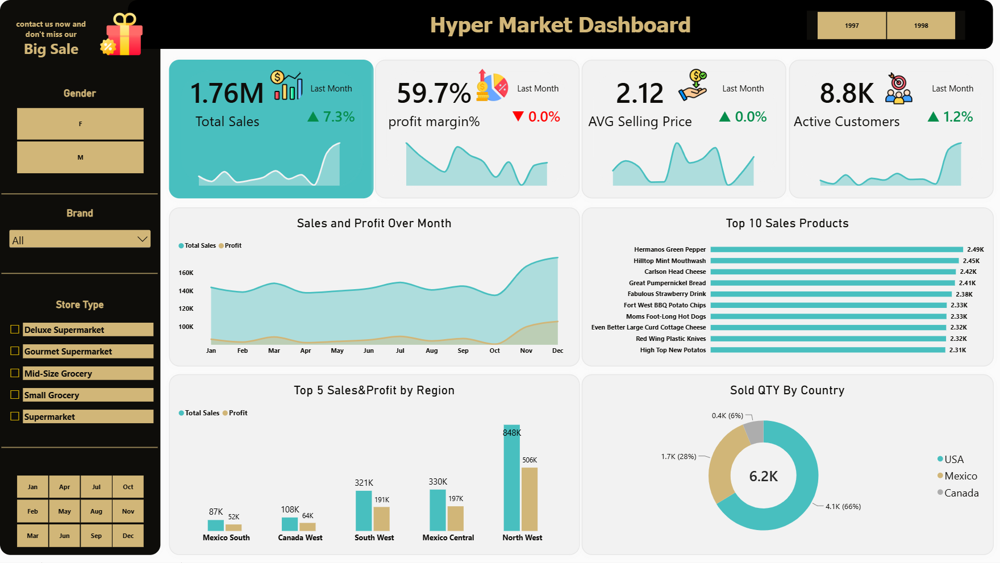

# Hyper Market Sales Analysis | Power BI

## Project Overview
An interactive Power BI dashboard designed to analyze hypermarket sales performance, profitability, product performance, regional sales, and customer activity across 1997 and 1998.

## 👨‍💻 My Contribution

I independently developed this Power BI project from end to end, transforming the provided raw data sheets into an interactive sales analysis dashboard.

My responsibilities included:

- **Data Preparation:** Cleaning and transforming data using Power Query.
- **Data Modeling:** Designing the data model and establishing relationships between tables.
- **DAX Measures:** Developing custom measures to calculate KPIs and business metrics.
- **Dashboard Design:** Building an interactive dashboard with a clear and user-friendly layout.
- **Business Analysis:** Analyzing sales performance, profitability, and customer-related metrics to identify meaningful insights.

**Data Source:** The dataset was provided from an external source. The data modeling, DAX calculations, analytical approach, and dashboard design were independently developed by me.

## Key Performance Indicators (KPIs)
- **Total Sales:** 1.76M
- **Profit Margin:** 59.7%
- **Average Selling Price:** 2.12
- **Active Customers:** 8.8K

## Key Analysis Areas
- **Sales & Profit Trends:** Monthly comparison of sales and profit.
- **Top 10 Products:** Identifying leading products by sales.
- **Regional Performance:** Comparing sales and profit across regions.
- **Sales Quantity by Country:** Analyzing the contribution of each country to total quantity sold.
- **Customer Analysis:** Monitoring active customer activity.
- **Interactive Filtering:** Exploring results by year, gender, brand, store type, and month.

## Tools & Skills
- Power BI Desktop
- DAX Measures
- Data Modeling
- Data Visualization
- KPI Development
- Interactive Dashboard Design

## Dashboard Preview
The dashboard provides a consolidated view of key business metrics and enables users to explore sales and profitability across different business dimensions.

## Project Files
- `Hyper Market.pbix` — Power BI dashboard file.

## Dashboard Preview

